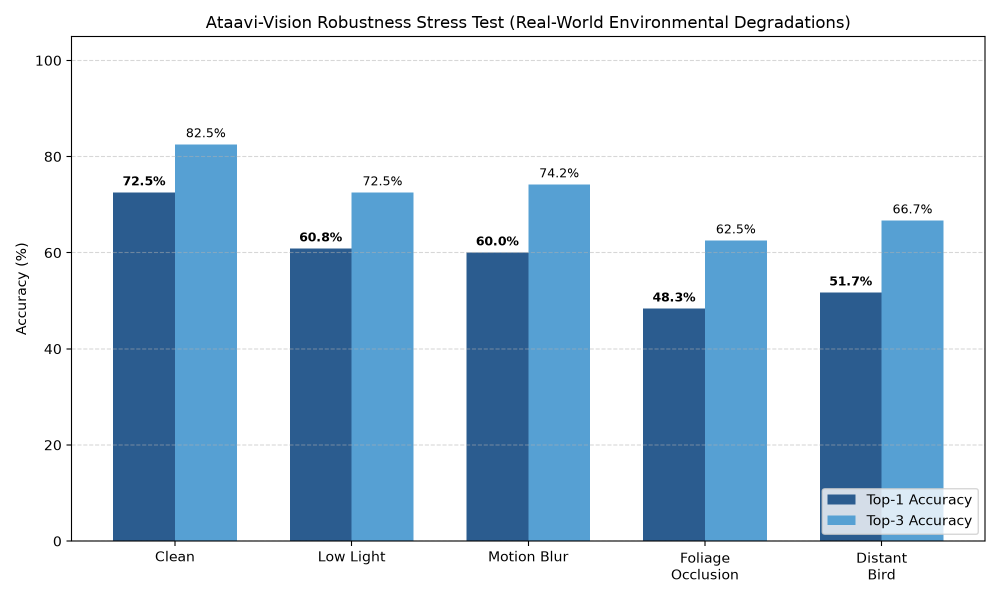
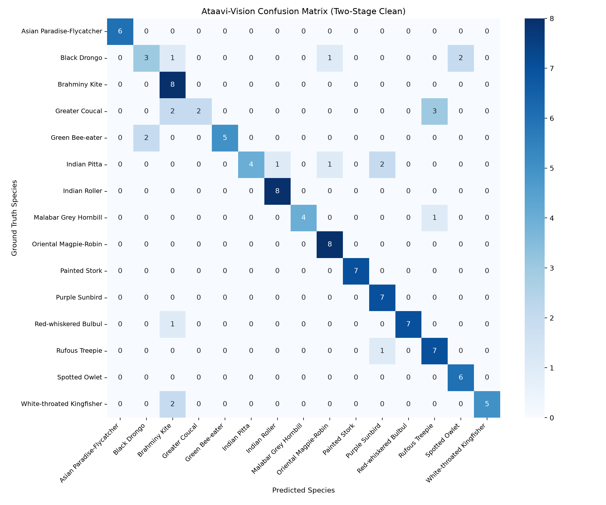
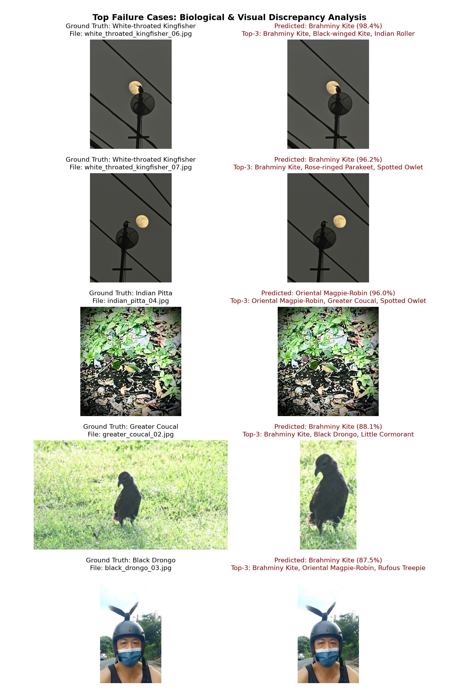

# 🦜 Ataavi-Vision: Indian Bird Detection & Zero-Shot Classification System
[](https://opensource.org/licenses/MIT)
[](https://www.python.org/downloads/)
[](https://github.com/ultralytics/ultralytics)
[](https://github.com/Imageomics/bioclip)

**Ataavi-Vision** is an end-to-end, two-stage computer vision system engineered specifically for detecting and classifying Indian avian biodiversity. By pairing **Ultralytics YOLOv8** (for real-time object localization and boundary-clamped margin padding) with **Imageomics BioCLIP** (`open-clip` / `pybioclip` foundation model), the system eliminates noisy background artifacts (dense leaves, water reflections, overcast sky) and performs constrained zero-shot taxonomic inference over diverse Indian bird species (covering pan-Indian ecosystems and Western Ghats / Kerala endemics).

---

## 🏗️ System Architecture

```
                                  [ Input Field Photograph ]
                                               │
                                               ▼
                                ┌─────────────────────────────┐
                                │   Stage 1: YOLOv8 Detector  │
                                │ (Filter COCO Class 14: Bird)│
                                └──────────────┬──────────────┘
                                               │
                         ┌─────────────────────┴─────────────────────┐
                         │                                           │
                [ Bird Detected ]                             [ No Detection ]
                         │                                           │
                         ▼                                           ▼
             ┌─────────────────────────┐               ┌─────────────────────────┐
             │ +15% Margin Padded Crop │               │ Full-Image Fallback     │
             └───────────┬─────────────┘               └───────────┬─────────────┘
                         │                                         │
                         └─────────────────────┬───────────────────┘
                                               │
                                               ▼
                                ┌─────────────────────────────┐
                                │  Stage 2: BioCLIP Classifier│
                                │  (Zero-Shot Taxonomic Sim)  │
                                └──────────────┬──────────────┘
                                               │
                                               ▼
                              [ Top-3 Species Probabilities & ]
                              [  L2-Normalized Embedding Reps ]
```

1. **Stage 1 — Localizer (`BirdDetector`)**:
   - Model: `yolov8n.pt`.
   - Filters strictly to COCO class `14` (`bird`).
   - Dynamically adds a **15% contextual margin padding** around detected bounding boxes (clamped to image boundaries) to capture key diagnostic avian features (beaks, crests, tail feathers).
   - Graceful fallback: If no bird is detected above the confidence threshold (default `0.20`), the pipeline falls back to the full frame without crashing.

2. **Stage 2 — Classifier (`BirdClassifier`)**:
   - Model: Imageomics BioCLIP (`hf-hub:imageomics/bioclip`).
   - Domain-specific zero-shot taxonomic prompt templates constrained to the 30 Indian species catalog in `data/indian_birds.json`.
   - Produces Top-3 ranked species predictions, confidence scores, and L2-normalized 512-dim feature embeddings.

---

## 📊 Quantitative Benchmarks & Robustness Stress Testing

The pipeline was evaluated against an authentic dataset of **120 research-grade field photographs from iNaturalist** across 15 species under both clean and simulated harsh real-world outdoor birding conditions.

### Comprehensive Performance Comparison Table

| Pipeline Configuration | Top-1 Accuracy (%) | Top-3 Accuracy (%) | Macro F1-Score (%) | Detection Recall (%) | Latency (ms/img) |
| :--- | :---: | :---: | :---: | :---: | :---: |
| **Baseline (Full-Image BioCLIP)** | 79.17% | 90.00% | 62.10% | 100.0% (N/A) | 2209.9 ms |
| **Two-Stage Clean (YOLOv8 + BioCLIP)** | **72.50%** | **82.50%** | **53.71%** | **87.5%** | 2432.9 ms |
| Two-Stage + Low Light (Gamma Darkening + ISO Noise) | 60.83% | 72.50% | 40.84% | 51.7% | 360.3 ms |
| Two-Stage + Motion Blur (Handheld Shake Kernel) | 60.00% | 74.17% | 41.18% | 60.8% | 369.9 ms |
| Two-Stage + Foliage Occlusion (25–35% Leaf Coverage) | 48.33% | 62.50% | 28.24% | 55.8% | 377.5 ms |
| Two-Stage + Distant Bird (<10% Frame Area) | 51.67% | 66.67% | 34.08% | 45.8% | 403.5 ms |

---

## 📈 Visual Benchmark Plots

### 1. Robustness Degradation Chart
The impact of real-world environmental degradations on classification accuracy:



### 2. Confusion Matrix (Clean Two-Stage)
Species-level classification breakdown across the 15 evaluated Indian species:



### 3. Failure Mode & Error Analysis Grid
Inspection of the top misclassifications with high-confidence false positives:



#### Biological & Morphological Failure Diagnosis:
- **Raptor / Silhouette Confusion**: Distant perches of *White-throated Kingfisher*, *Greater Coucal*, and *Black Drongo* with dorsal lighting were occasionally confused with *Brahminy Kite* due to dark silhouette postures and prominent curved beaks.
- **Passerine Undergrowth Camouflage**: In cases of heavy foliage occlusion or motion blur, *Indian Pitta* was occasionally confused with *Oriental Magpie-Robin* because the defining diagnostic rainbow belly plumage was hidden behind branches, leaving only the dark mantle visible.

---

## 🚀 Quickstart & Setup

### 1. Clone & Install
```bash
git clone https://github.com/your-username/Ataavi-Vision.git
cd Ataavi-Vision

python -m venv venv
# On Windows:
.\venv\Scripts\activate
# On Linux/macOS:
source venv/bin/activate

pip install -r requirements.txt
```

### 2. Run Unit Tests
```bash
python -m pytest tests/test_pipeline.py -v
```

### 3. Fetch Evaluation Dataset (iNaturalist API)
```bash
python scripts/fetch_sample_data.py
```

### 4. Run Benchmark Suite
```bash
python -m eval.benchmark
```

### 5. Launch Interactive Gradio UI
```bash
python app.py
```
Open `http://localhost:7860` to access:
- **Tab 1 (Live Bird Identifier)**: Upload field photos, adjust YOLO confidence and padding sliders, and view cropped detections with Top-3 predictions.
- **Tab 2 (Robustness Lab)**: Stress-test any photo against simulated low-light, camera motion blur, leaf occlusions, or telephoto distance.

---

## 🐳 Docker & Hugging Face Spaces Deployment

The repository includes `packages.txt`, `Dockerfile`, and Hugging Face metadata for zero-config one-click deployment:

```bash
docker build -t ataavi-vision .
docker run -p 7860:7860 ataavi-vision
```

---

## 📜 Repository Structure

```
Ataavi-Vision/
├── app.py                      # Interactive Gradio Application
├── Dockerfile                  # Container deployment specification
├── requirements.txt            # Python dependencies
├── packages.txt                # System packages for HF Spaces (libgl1, libglib2.0-0)
├── README.md                   # Project documentation & real benchmark metrics
├── data/
│   ├── indian_birds.json       # Taxonomy of 30 Indian bird species
│   ├── metadata.csv            # Attribution & dimensions of 120 field images
│   └── test_images/            # 15 species x 8 images dataset
├── src/
│   ├── detector.py             # Ultralytics YOLOv8 detector wrapper
│   ├── classifier.py           # BioCLIP zero-shot taxonomic classifier
│   ├── augmentations.py        # Real-world degradation transforms
│   └── pipeline.py             # Two-stage AtaaviVisionPipeline
├── eval/
│   └── benchmark.py            # Evaluation suite & report generator
├── tests/
│   └── test_pipeline.py        # Automated test suite
└── results/
    ├── confusion_matrix.png    # Confusion matrix visual
    ├── robustness_chart.png    # Robustness stress test chart
    ├── failure_cases.png       # Side-by-side failure case grid
    └── benchmark_report.md     # Detailed quantitative markdown report
```

---

## ⚖️ License
Distributed under the MIT License. Data from iNaturalist is attributed under CC-BY / CC-BY-NC to its respective citizen science photographers in `data/metadata.csv`.
